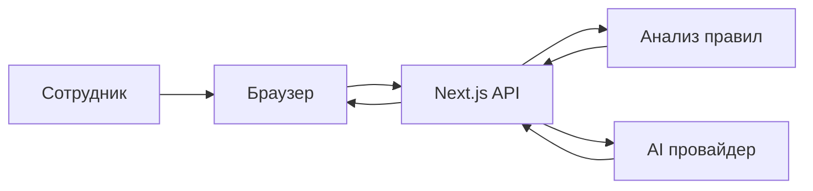

# Модель угроз: «генИИ»

## Executive summary

Главные риски — утечка текста письма внешнему AI-провайдеру, злоупотребление публичным дорогим endpoint, prompt injection и ошибочная рекомендация пользователю. Код снижает их явным согласием на AI-режим, серверной изоляцией ключа, ограниченным промптом, схемами, проверкой цитат, rate limit и сохранением сильных результатов правил. Решение не хранит письма и не выполняет ссылки или команды.

## Scope and assumptions

В области: `app/`, `components/`, `lib/`, конфигурация Next.js и deployment на Vercel. Тесты и scripts рассматриваются как dev-контур. Из ТЗ приняты: публичный rules-режим, ограниченный демонстрационный AI, отсутствие аккаунтов и хранения, предполагаемое публичное HTTPS-развёртывание. Реальный объём трафика неизвестен; in-memory rate limit достаточен только для одного процесса и учебной демонстрации.

## System model

### Primary components

- Браузерный интерфейс — `components/EmailAnalyzer.tsx`.
- POST endpoint — `app/api/analyze/route.ts`.
- Детерминированный модуль — `lib/analyzer/*`.
- Внешний OpenAI-compatible провайдер — только через `lib/ai/client.ts` при конфигурации.

### Data flows and trust boundaries

- Пользователь → браузер: текст письма; локального хранения нет.
- Браузер → Route Handler: JSON по HTTPS; Zod, 12 000 символов, общий rate limit, `no-store`.
- Route Handler → правила: строка в памяти; детерминированный поиск без I/O.
- Route Handler → AI-провайдер: текст и системный prompt по HTTPS; тайм-аут, запрет redirect, отдельный rate limit и optional access token.
- AI-провайдер → Route Handler: недоверенный JSON; schema validation и точное наличие каждой цитаты в исходном тексте.

## Assets and security objectives

| Asset | Why it matters | C/I/A |
| --- | --- | --- |
| Текст письма | Может содержать коммерческие и персональные данные | C, I |
| `AI_API_KEY` и `AI_ACCESS_TOKEN` | Дают доступ к платному внешнему сервису | C, A |
| Результат и рекомендации | Ошибка может привести к платежу или утечке доступа | I |
| API/бюджет провайдера | Публичное злоупотребление создаёт расходы/отказ | A |
| Код правил и lock-файл | Определяют воспроизводимость и доверие к результату | I |

## Attacker model

### Capabilities

Удалённый пользователь может отправлять произвольный JSON и текст до сетевых/серверных ограничений, повторять запросы, внедрять инструкции для модели и возвращать вредоносные формулировки в письме. Внешний AI-провайдер рассматривается как отдельная доверительная сторона.

### Non-capabilities

Нет загрузки файлов, базы, аккаунтов, выполнения shell/кода, инструментов модели и автоматического перехода по ссылкам. Атакующий не должен иметь доступ к env Vercel или исходному серверу.

## Entry points and attack surfaces

| Surface | How reached | Boundary | Notes | Evidence |
| --- | --- | --- | --- | --- |
| `POST /api/analyze` | Публичный HTTP | Интернет → сервер | JSON, стоимость AI, DoS | `app/api/analyze/route.ts:POST` |
| Текстовое поле | Пользовательский ввод | Пользователь → React | XSS/длинный текст | `components/EmailAnalyzer.tsx` |
| AI response | Ответ провайдера | Внешний сервис → сервер | Поддельные цитаты/JSON | `lib/ai/client.ts:modelOutputSchema` |
| env | Хостинг | Оператор → сервер | Ключи и endpoint | `lib/ai/client.ts:config` |

## Top abuse paths

1. Атакующий вставляет prompt injection → текст передаётся модели как данные → модель пытается подчиниться → сервер принимает только схему и существующие цитаты; правила остаются в результате.
2. Бот повторяет AI-запросы → расходует квоту → отдельный лимит снижает частоту, но распределённый обход остаётся возможен.
3. Пользователь включает AI для конфиденциального письма → текст уходит провайдеру → возможна внешняя обработка; UI предупреждает до отправки.
4. Вредоносный HTML попадает в письмо → API возвращает строку → React экранирует JSX; raw HTML sinks не используются.
5. Модель называет письмо безопасным → merge не понижает уровень правил → сильные программные признаки сохраняются.
6. Длинное тело истощает ресурсы → Content-Length precheck и Zod max ограничивают приложение; edge limit требуется дополнительно.

## Threat model table

| ID | Threat | Existing controls | Gaps | Recommendation | Likelihood | Impact | Priority |
| --- | --- | --- | --- | --- | --- | --- | --- |
| TM-001 | Prompt injection меняет AI verdict | Изолированный system prompt, один вызов без tools, Zod, проверка цитат, merge без понижения | Модель всё равно может дать неверное объяснение | Регулярные adversarial-тесты; показывать provenance каждого признака | High | Medium | High |
| TM-002 | Утечка текста внешнему провайдеру | AI выключен по умолчанию; явное предупреждение; HTTPS; no logs/no store | Политика хранения зависит от выбранного провайдера | Выбирать договорного провайдера и документировать retention | Medium | High | High |
| TM-003 | Кража API-ключа | Только server env, `server-only`, `.env*` ignored, нет `NEXT_PUBLIC_*` | Компрометация хостинга вне кода | Ограничить ключ по бюджету/проекту, ротация и billing alert | Low | High | Medium |
| TM-004 | Массовое расходование AI | 5 запросов/мин/IP, optional `AI_ACCESS_TOKEN`, тайм-аут | In-memory/IP легко обходятся на serverless | Production KV/edge rate limit и обязательный access control | High | Medium | High |
| TM-005 | XSS через текст письма | JSX escaping, нет `dangerouslySetInnerHTML`, CSP, текстовые blockquote | CSP содержит style `unsafe-inline` для Next styles | Ужесточить style policy при изменении build pipeline | Low | High | Medium |
| TM-006 | Ошибочный низкий риск | Ограничения в UI, объяснимость, rules не обещают безопасность | Эвристика имеет FN; отправитель/вложения не видны | Обязательная независимая проверка для платежей; расширять корпус | Medium | High | High |
| TM-007 | DoS большим/частым вводом | 30 запросов/мин/IP, 30 KB precheck, 12 000 символов | Нет распределённого edge limit | Настроить Vercel Firewall/KV; следить за 429 и latency | Medium | Medium | Medium |

## Criticality calibration

- Critical: удалённое выполнение кода или массовая утечка ключей/писем. Таких путей в текущей архитектуре не обнаружено.
- High: устойчивое обходное расходование платного API, скрытая передача текста, систематически опасный verdict.
- Medium: локальный DoS отдельного процесса, ограниченная XSS-защита при будущей ошибке, одиночная ложная рекомендация.
- Low: раскрытие несекретной конфигурации или визуальная деградация без влияния на решение.

## Focus paths for security review

| Path | Why it matters | Threat IDs |
| --- | --- | --- |
| `app/api/analyze/route.ts` | Публичная граница, лимиты и fallback | TM-002, TM-004, TM-007 |
| `lib/ai/client.ts` | Ключ, outbound URL, prompt и недоверенный ответ | TM-001, TM-002, TM-003 |
| `lib/analyzer/rules.ts` | Целостность цитат и ложные результаты | TM-006 |
| `components/EmailAnalyzer.tsx` | Отображение недоверенного текста и согласие на AI | TM-002, TM-005 |
| `next.config.ts` | Security headers/CSP | TM-005 |

Остаточный главный риск — человеческое восприятие результата как гарантии. Тексты интерфейса намеренно избегают слова «безопасно» и повторяют ограничение метода.
